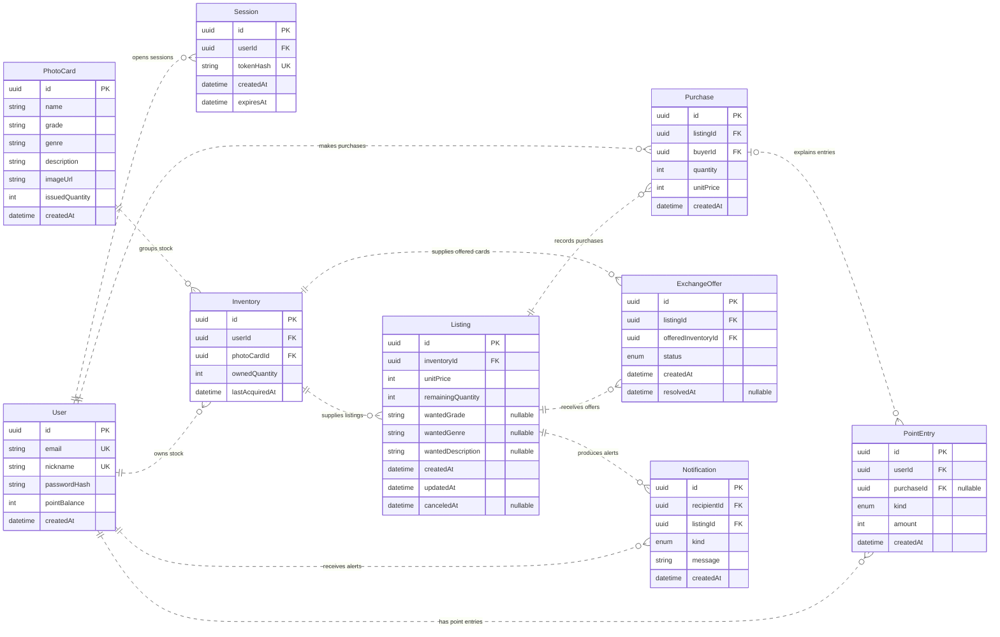

# 최애의 포토 데이터베이스 설계

PostgreSQL을 사용하는 현재 [Prisma 스키마](../api/prisma/schema.prisma)의 모델 9개와 관계 12개를 설명한다. [ERD 초안](ERD.md)의 거래 규칙과 [API 계약](api.md)을 구현할 때 어떤 데이터를 저장하고 어떤 값을 계산할지 확인하는 문서다.

## ERD



`PK`는 기본 키, `FK`는 외래 키, `UK`는 단일 컬럼 고유 키다. 모든 기본 키와 외래 키는 UUID를 사용한다. `Inventory`의 `(userId, photoCardId)`는 복합 고유 키다. 외래 키가 자식의 기본 키에 포함되지 않아 관계선은 점선으로 표시했다. 관계가 필수인지 여부는 양쪽 끝의 기호로 확인한다.

## Database structure in ASCII

```text
PARENT MODEL       PARENT END            CHILD END   CHILD MODEL       FOREIGN KEY
----------------   ----------            ---------   ---------------   ------------------
User               1     +------------+  0..N       Session           userId
User               1     +------------+  0..N       Inventory         userId
PhotoCard          1     +------------+  0..N       Inventory         photoCardId
Inventory          1     +------------+  0..N       Listing           inventoryId
Listing            1     +------------+  0..N       Purchase          listingId
User               1     +------------+  0..N       Purchase          buyerId
Listing            1     +------------+  0..N       ExchangeOffer     listingId
Inventory          1     +------------+  0..N       ExchangeOffer     offeredInventoryId
User               1     +------------+  0..N       PointEntry        userId
Purchase           0..1  +------------+  0..N       PointEntry        purchaseId
User               1     +------------+  0..N       Notification      recipientId
Listing            1     +------------+  0..N       Notification      listingId

Legend
  1     = exactly one (mandatory)
  0..1  = zero or one (optional)
  0..N  = zero or many (optional)
  Each end gives the count of that model for one row at the opposite end.
  Foreign keys are required except PointEntry.purchaseId.
  Inventory links User and PhotoCard (many-to-many conceptually).
  UNIQUE (Inventory.userId, Inventory.photoCardId) allows one row per pair.
```

## 관계차수와 선택성

‘부모 한 행당 자식’은 예를 들어 **회원 한 명이 세션을 몇 개 가질 수 있는지**, ‘자식 한 행당 부모’는 **세션 하나가 회원 몇 명에 속하는지**를 뜻한다. `0..N`은 자식이 없어도 부모를 저장할 수 있다는 의미다.

| 부모 모델 | 자식의 외래 키 | 부모 한 행당 자식 | 자식 한 행당 부모 |
| --- | --- | --- | --- |
| `User` | `Session.userId` | 0..N · 선택 | 1 · 필수 |
| `User` | `Inventory.userId` | 0..N · 선택 | 1 · 필수 |
| `PhotoCard` | `Inventory.photoCardId` | 0..N · 선택 | 1 · 필수 |
| `Inventory` | `Listing.inventoryId` | 0..N · 선택 | 1 · 필수 |
| `Listing` | `Purchase.listingId` | 0..N · 선택 | 1 · 필수 |
| `User` | `Purchase.buyerId` | 0..N · 선택 | 1 · 필수 |
| `Listing` | `ExchangeOffer.listingId` | 0..N · 선택 | 1 · 필수 |
| `Inventory` | `ExchangeOffer.offeredInventoryId` | 0..N · 선택 | 1 · 필수 |
| `User` | `PointEntry.userId` | 0..N · 선택 | 1 · 필수 |
| `Purchase` | `PointEntry.purchaseId` | 0..N · 선택 | 0..1 · 선택 |
| `User` | `Notification.recipientId` | 0..N · 선택 | 1 · 필수 |
| `Listing` | `Notification.listingId` | 0..N · 선택 | 1 · 필수 |

회원과 카드 종류는 개념적으로 **다대다(N:M)**다. 예를 들어 지우는 별 카드와 달 카드를 보유하고, 별 카드는 민수도 보유할 수 있다. 실제 DB에서는 `Inventory`로 연결하여 `User → Inventory`와 `PhotoCard → Inventory` 두 개의 1:N 관계로 저장한다. 같은 회원과 카드 종류 조합에는 보유 행이 하나만 존재한다.

`PointEntry.purchaseId`만 선택 외래 키다. 가입 보너스와 랜덤 상자 적립에는 구매가 연결되지 않는다. 스키마상 구매에는 포인트 내역을 0개 이상 연결할 수 있으며, 서비스는 **결제액이 있는 구매에 차감 1건·적립 1건**, **0P 구매에 포인트 내역 0건**을 적용한다.

## 모델별 저장 기준

| 모델 | 저장 단위 | 핵심 키와 역할 |
| --- | --- | --- |
| `User` | 회원 한 명 | 이메일·닉네임의 고유 제약을 두고 비밀번호 해시와 현재 포인트 잔액을 저장한다. |
| `Session` | 로그인 세션 한 건 | 회원 FK와 고유한 토큰 해시를 저장한다. 만료 시각은 발급 시점 기준 24시간이다. |
| `PhotoCard` | 카드 종류 하나 | 이름, 등급, 장르, 설명, 이미지 URL, 초기 발행량을 저장한다. 초기 카드는 시드로 공급한다. |
| `Inventory` | 회원과 카드 종류 한 쌍 | 회원 FK와 카드 종류 FK의 조합이 고유하다. 소유권이 이전되기 전에는 판매·교환 대기 중인 수량도 총 보유 수량에 포함한다. 마지막 획득 시각은 시드 지급·구매·교환으로 카드를 받을 때 갱신하며 갤러리 정렬에 사용한다. |
| `Listing` | 판매 등록 한 건 | 판매에 사용한 보유 행을 가리킨다. 장당 가격과 판매 잔여 수량을 저장한다. 교환 희망 등급·장르·설명과 취소 시각은 선택이다. |
| `Purchase` | 성공한 구매 한 건 | 판매글과 구매자를 가리키고 구매 수량과 당시 장당 가격을 저장한다. 판매자와 카드 종류는 연결된 판매글과 보유 행에서 찾는다. |
| `ExchangeOffer` | 카드 한 장의 교환 제안 한 건 | 대상 판매글과 제안자가 제공한 보유 행을 가리킨다. 상태와 선택인 처리 시각을 저장한다. |
| `PointEntry` | 포인트 지급 또는 차감 한 건 | 회원과 지급·차감 유형, 증감액을 저장한다. 구매 차감과 판매 적립에는 구매 FK를 연결한다. |
| `Notification` | 특정 수신자에게 전달할 알림 한 건 | 수신자와 판매글을 가리키고 이벤트 종류, 당시 표시 문구와 발생 시각을 저장한다. |

판매 취소 이력은 `Listing.canceledAt`과 취소 당시의 `remainingQuantity`로 제공한다. 취소 건은 마켓플레이스에서 제외하며 판매자 자신의 목록과 상세에서만 확인할 수 있다. `Notification.kind`의 `LISTING_CANCELED`는 자동 종료된 대기 제안의 제안자에게 표시할 알림이다.

## 정규화 적용

| 정규형 | 적용 방식 | 예시 |
| --- | --- | --- |
| 1NF | 한 칸에는 한 값을 저장하고 반복 항목은 행으로 나눈다. | 여러 구매 ID를 판매글의 한 컬럼에 모으는 대신 `Purchase`에 구매 한 건당 한 행을 저장한다. |
| 2NF | 회원과 카드 종류의 복합 후보 키를 갖는 보유 관계에는 그 조합에 속하는 값만 둔다. | `Inventory.ownedQuantity`는 특정 회원이 특정 카드 종류를 얼마나 갖는지 나타낸다. 카드 이름과 등급은 카드 종류에만 속하므로 `PhotoCard`에 저장한다. |
| 3NF | 다른 모델의 속성은 해당 모델에서 관리하고 관계를 따라 조회한다. | `Purchase`에서 판매자나 카드 종류를 조회할 때 `Purchase → Listing → Inventory`를 따른다. 회원 닉네임과 카드 이름은 구매 행에 복제하지 않는다. |

현재 잔액 `User.pointBalance`는 빠른 잔액 확인을 위해 포인트 내역의 합계와 함께 관리하는 값이다. 적립·차감 시 `PointEntry`와 같은 트랜잭션에서 갱신해 차이를 막는다. `Purchase.unitPrice`는 구매 당시 합의된 가격이고, `Listing.unitPrice`는 변경 가능한 현재 가격이다. 알림의 `message`도 이벤트 당시 표시 내용을 보존한다.

표시할 결제액은 구매 수량과 당시 장당 가격을 곱해 계산한다. 판매 상태는 취소 시각과 잔여 수량으로 판단한다. 알림 상대 시간은 발생 시각을, 랜덤 상자 재이용 시각은 최근 상자 적립 시각을 기준으로 계산한다.

## 수량과 거래 일관성

| 규칙 | 적용 위치 |
| --- | --- |
| 총 보유 수량에서 활성 판매 잔여 수량과 대기 제안 수를 빼면 거래 가능 수량이 된다. 갤러리 표시 수량에서는 판매 중인 수량만 제외한다. | 조회와 판매·교환 서비스에서 계산한다. |
| 교환 제안 카드와 판매 대상 카드의 종류가 서로 달라야 한다. | 제안 생성 서비스에서 양쪽 `photoCardId`를 비교한다. |
| 구매·교환 시 소유권을 이전하고 판매 잔여 수량을 줄인다. 판매 취소나 품절 시 남은 대기 제안을 종료한다. | 동일 거래를 한 트랜잭션으로 처리한다. 판매가 취소되면 그 거래에서 대기 제안자마다 판매 취소 알림을 한 건 저장한다. |
| 보유 수량, 판매 잔여 수량, 잔액, 장당 가격은 0 이상이다. 구매 수량과 발행량은 양수다. | PostgreSQL `CHECK` 제약을 추가할 마이그레이션과 서비스 검증에 반영한다. |
| 같은 카드 종류의 전체 소유 수량은 초기 발행량과 일치한다. | 시드와 거래의 수량 검증에서 확인한다. |

카드 등급은 `COMMON`, `RARE`, `SUPER RARE`, `LEGENDARY`다. 장르 허용 목록은 초기 시드 데이터 작성 때 확정하며, API는 같은 목록을 사용한다. 알림 읽음 처리와 안 읽은 개수는 선택 기능이다.
