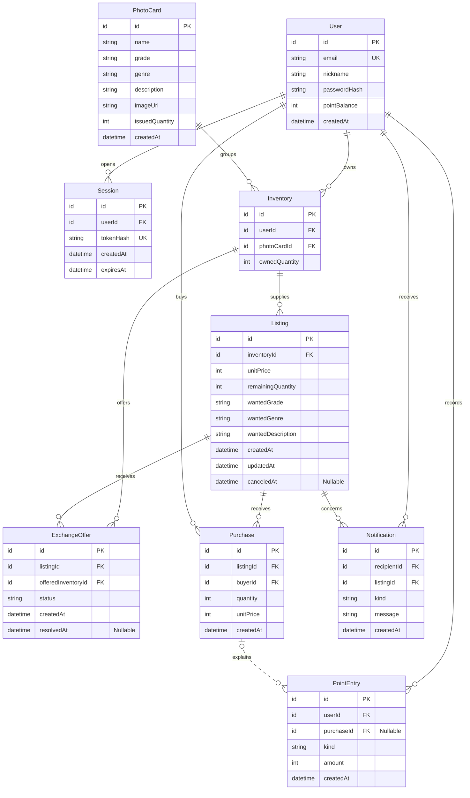

# 최애의 포토 ERD 초안

[프로젝트 계획](plan.md)과 [결정 기록](ADR.md)을 바탕으로 작성한 논리 데이터 모델이다. 12월 4일 배포의 **시드 카드 판매 등록 → 10P로 여러 장 구매 → 마이 갤러리 반영**과 최종 제출의 교환·포인트 상자·거래 알림을 다룬다.

## 관계도

`PK`는 기본 키, `FK`는 외래 키, `UK`는 고유 키다. `id`는 식별자 타입을 뜻하며, 구체적인 저장 타입은 스키마 단계에서 정한다. `Inventory`의 `(userId, photoCardId)` 조합도 고유하다.

| 엔터티 | 저장하는 정보 |
| --- | --- |
| `User` | 로그인 계정과 현재 포인트 잔액. 비밀번호는 해시를 저장한다. |
| `Session` | 회원 로그인 세션. 발급한 토큰의 해시를 저장하고 발급 시점부터 24시간 동안 유효하다. 로그아웃하면 세션을 폐기한다. |
| `PhotoCard` | 시드로 준비하는 카드 종류와 총 발행량. 장당 거래 가격은 판매 등록에 저장한다. |
| `Inventory` | 회원과 카드 종류별 총 보유 수량. 판매와 교환에 잡혀 있는 수량도 소유권이 이전될 때까지 여기에 포함된다. |
| `Listing` | 판매 가격, 남은 수량, 교환 희망 조건과 취소 시각. 판매자와 카드 종류는 등록에 사용한 보유 기록으로 확인한다. |
| `Purchase` | 완료한 구매의 구매자·수량·당시 장당 가격. 결제액은 구매 당시의 장당 가격과 수량을 곱해 계산한다. |
| `ExchangeOffer` | 대상 판매글과 제안할 카드 한 장의 보유 기록, 처리 상태. 제안자와 제안 카드 종류는 보유 기록으로 확인한다. |
| `PointEntry` | 가입 보너스, 랜덤 상자, 구매 차감, 판매 적립으로 바뀐 포인트 내역. 결제액이 있는 구매는 구매자 차감과 판매자 적립 두 건에 연결된다. |
| `Notification` | 알림 수신자, 관련 판매글, 이벤트 종류, 발생 시각과 표시 내용. 상대 시간은 발생 시각을 기준으로 표시한다. |

## 수량, 상태, 포인트 규칙

- **보유 수량과 거래 가능 수량.** 거래 가능 수량은 총 보유 수량에서 활성 판매의 남은 수량 합계와 대기 중인 교환 제안 수를 뺀 값이다. 이 값은 0 이상이어야 한다. 판매 등록과 교환 제안은 거래 가능 수량을 사용한다. 마이 갤러리에서는 판매 중인 수량을 제외하고, 교환 대기 중인 카드는 보유 수량에 포함해 보여준다. 회원·카드 조합을 식별하는 보유 기록은 수량이 0이 되어도 유지해 이전 거래를 조회할 수 있게 한다.
- **판매 가격과 상태.** 판매자가 정한 장당 가격은 0P 이상이다. 취소 시각이 있으면 취소, 취소 시각이 없고 남은 수량이 0이면 품절, 그 외에는 판매 중으로 해석한다. 판매를 취소하면 남아 있던 수량은 다시 거래 가능해진다. 구매나 교환으로 소진된 수량만 소유권이 이전된다.
- **교환 상태.** 제안은 대기에서 승인·거절·제안자 취소·판매 취소에 따른 종료·품절에 따른 종료 중 하나로 이동한다. 대기 제안 한 건마다 제안자의 카드 한 장을 잡아 둔다. 승인 시 판매자 카드와 제안자 카드 한 장씩을 이전하고 판매 잔여 수량을 한 장 줄인다. 판매가 취소되거나 품절되면 같은 판매글의 남은 대기 제안을 종료한다. 교환 희망 조건은 참고 정보다.
- **구매와 동시 요청.** 판매 잔여 수량과 구매자 잔액을 거래 시점에 다시 확인한다. 양쪽 보유 수량과 구매 기록, 판매 잔여 수량을 하나의 트랜잭션으로 처리한다. 결제액이 있으면 같은 트랜잭션에서 포인트 잔액과 차감·적립 내역도 갱신한다. 0P 구매는 소유권 이전과 구매 기록을 저장하고 양쪽 포인트 잔액은 유지한다. 구매·교환 승인·판매 취소가 같은 판매글에 겹치거나 여러 거래가 같은 보유 수량을 사용하면, 변경 대상의 최신 상태를 기준으로 한 요청씩 처리한다.
- **포인트 적립.** 잔액을 갱신할 때 포인트 내역을 같은 트랜잭션에 저장한다. 신규 회원은 가입 시 10P를 한 번 받고, 첫 상자는 즉시 열 수 있다. 보상은 1P부터 5P까지의 정수이며, 1P가 가장 자주 나오고 5P로 갈수록 드물게 나온다. 다음 상자 이용 가능 시각은 최근 상자 적립 시각에서 한 시간 뒤다. 같은 회원의 상자 요청이 겹쳐도 한 번만 적립되도록 이용 가능 여부 확인과 내역 저장을 함께 처리한다.
- **초기 발행량.** 초기 카드와 보유 기록을 시드 판매자 계정에만 준비한다. 각 카드의 보유 수량 합계는 시드로 발행한 수량과 일치해야 한다. 판매 등록, 구매, 교환은 카드 종류별 총량을 늘리지 않는다.
- **알림.** 필수 알림은 교환 제안 도착·승인·거절, 구매 완료, 판매 성사, 품절이다. 읽음 처리와 미확인 개수를 구현할 때는 알림에 읽은 시각을 추가할 수 있다. 교환 대기자 대상 변경·취소·품절 알림은 [프로젝트 범위](plan.md)의 ‘있으면 좋음’에 따른다.

## 배포 흐름으로 검증

| 단계 | 예시 | 확인할 데이터 |
| --- | --- | --- |
| 초기 준비 | 시드 판매자가 카드 3장을 보유하고, 새 회원이 가입한다. | 판매자 보유 3장, 구매자 보유 0장과 잔액 10P. |
| 판매 등록 | 판매자가 3장을 장당 4P에 등록한다. | 판매자 총 보유 3장, 판매 잔여 3장, 해당 카드 거래 가능 수량 0장. |
| 2장 구매 | 새 회원이 8P로 2장을 구매한다. | 구매 기록 1건, 구매자 잔액 2P, 판매자 잔액 8P 증가, 판매 잔여 1장. |
| 갤러리 확인 | 두 회원이 보유 수량을 확인한다. | 구매자 마이 갤러리 2장. 판매자는 총 보유 1장 중 1장이 판매 중이다. |

교환 대기 표시의 예로, 지우가 사 온 별 카드 2장 중 1장을 교환으로 제안하면 마이 갤러리에는 별 카드 2장이 보이고, 새 거래에 사용할 수 있는 수량은 1장이다. 0P 판매의 예로, 마켓플레이스의 0P 카드 1장을 구매하면 소유권과 판매 수량은 바뀌고 결제액은 0P로 기록된다.

## 랜덤 상자 보상 확률

| 보상 | 확률 |
| --- | ---: |
| 1P | 40% |
| 2P | 25% |
| 3P | 18% |
| 4P | 12% |
| 5P | 5% |

상자 한 번의 평균 보상은 2.17P다.
